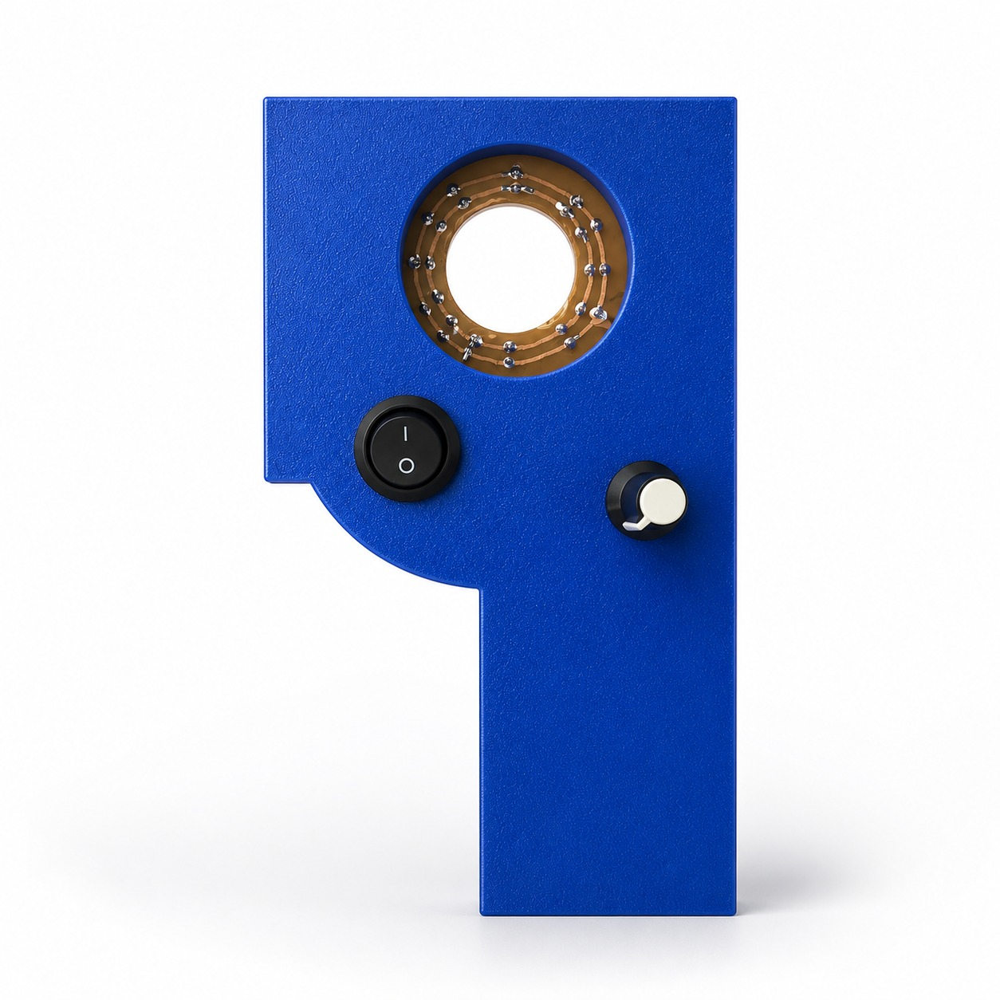
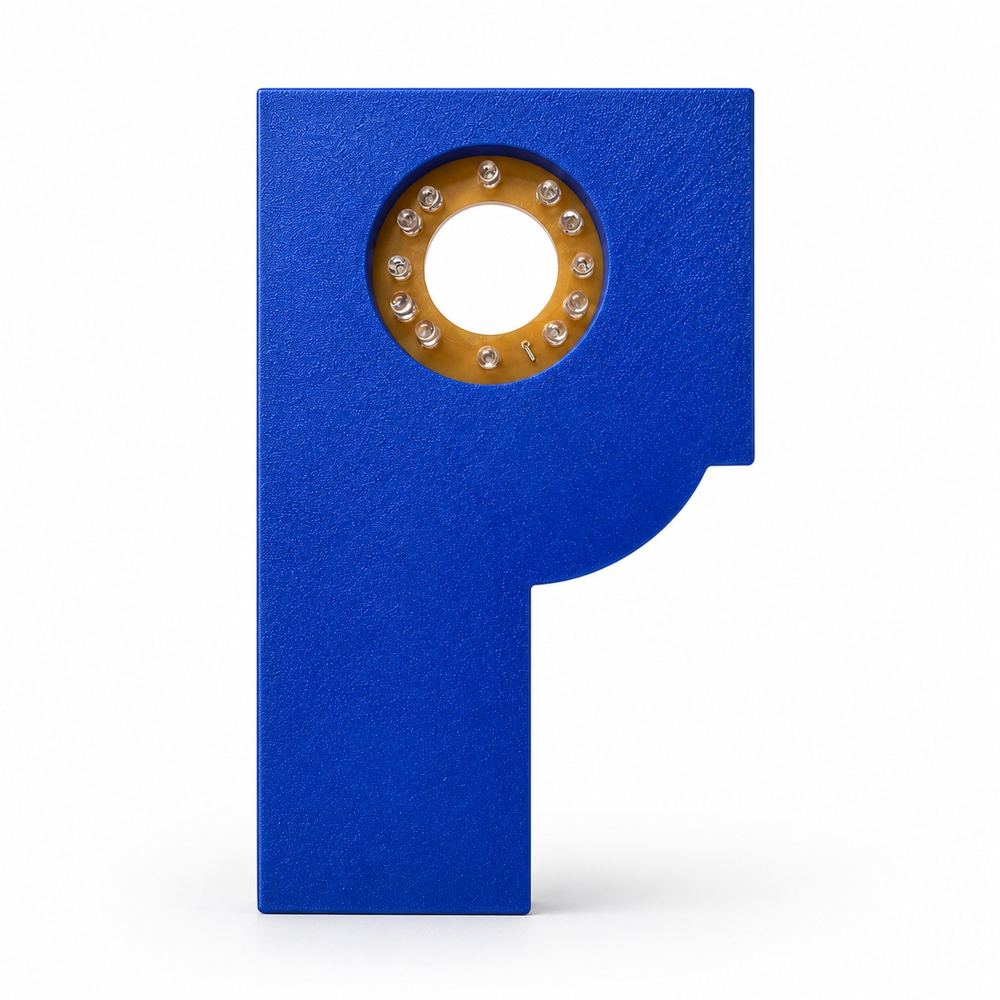
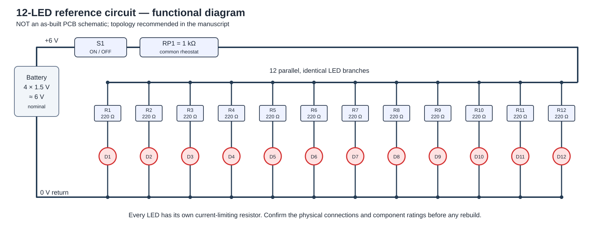
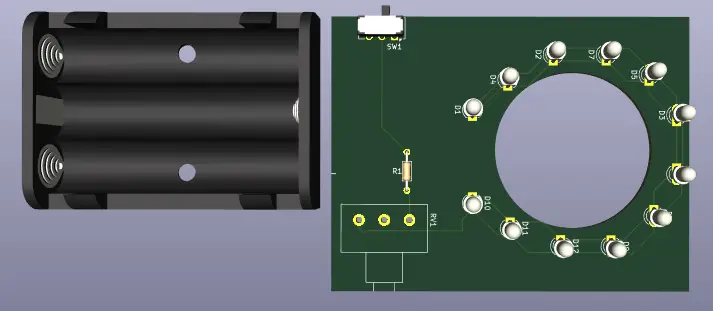
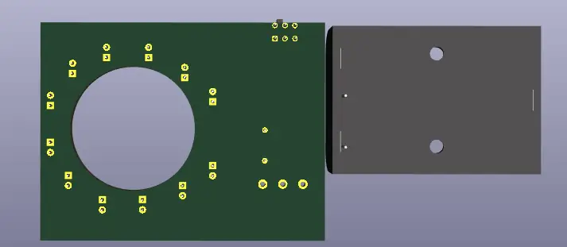
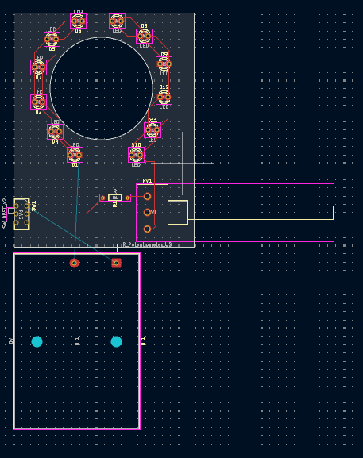
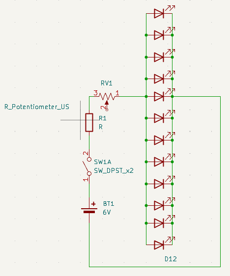
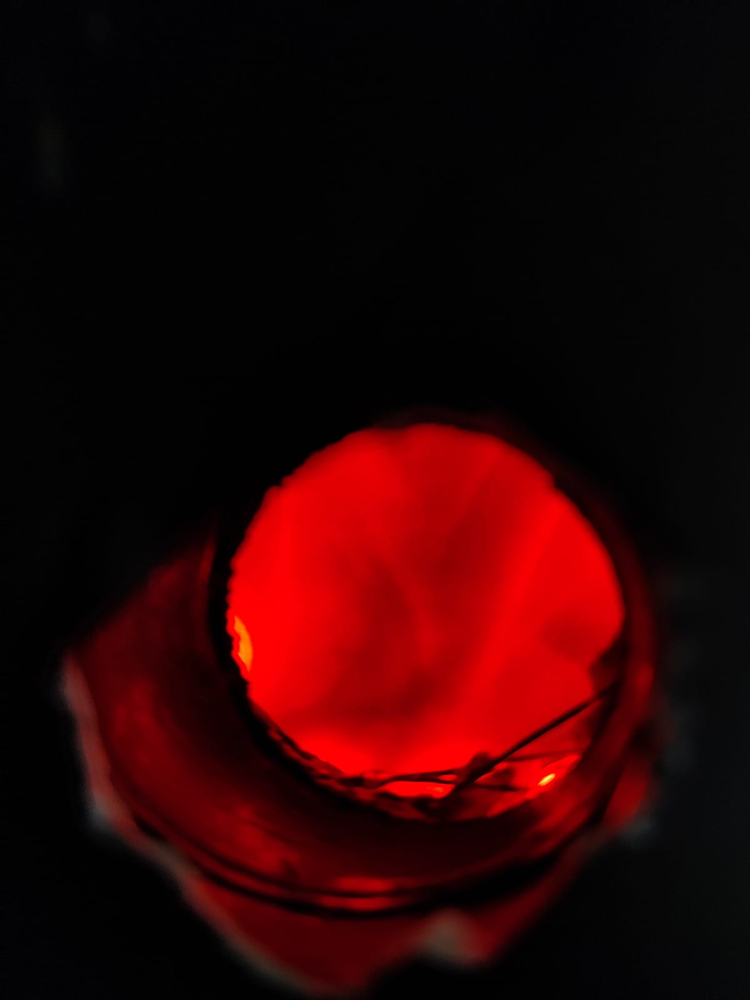
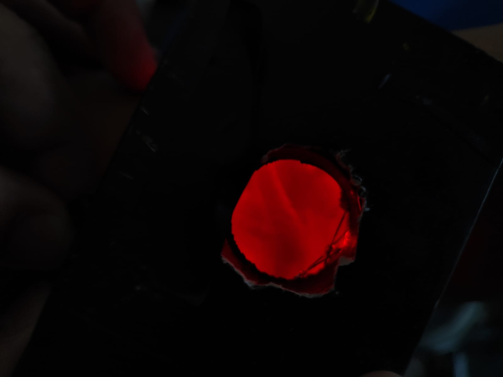

# Portable Low-Cost Red-LED Venoscope

**An academic biomedical-engineering prototype for qualitative visualization of superficial veins using visible red light.**

> **Research and education only.** This is not a certified medical device and must not be used to guide clinical venipuncture or make medical decisions. The reported observations are qualitative; the optical contrast values are theoretical predictions, not measurements.

[Read the full paper (PDF)](article/venoscope-paper.pdf) · [Português](README.pt-BR.md) · [Reproducibility checklist](docs/reproducibility-checklist.md)

## Prototype overview

The project investigates whether a compact ring of visible red LEDs can produce an observable difference between superficial venous structures and surrounding tissue. The reported prototype combines a **12-LED ring**, a central viewing aperture, a **3D-printed enclosure designed in Tinkercad**, a **manually etched copper PCB**, four 1.5 V batteries, an on/off switch, and a 1 kΩ potentiometer for brightness adjustment.

Unlike near-infrared vein finders, this implementation **does not use an NIR camera, digital image processing, or vein projection**. It relies on direct observation under reduced ambient illumination.

| Front view — paper Fig. 1 | LED-facing side — paper Fig. 2 |
|:--:|:--:|
|  |  |

*Images reproduced from the authors' manuscript. Editable KiCad files have now been supplied, but they have **not yet been verified** against the physical prototype.*

## Hardware specifications

| Property | Value / documentation status |
|---|---|
| Illumination | 12 visible red LEDs, 5 mm typical device assumed for calculations |
| LED peak wavelength | Approximately **630 nm, assumed**; exact LED part number and spectrum were not recorded |
| Supply | Four 1.5 V cells in series (**6 V nominal**) |
| User controls | On/off switch; 1 kΩ potentiometer wired as a rheostat |
| LED forward voltage in calculations | 2.2 V assumed |
| Current-limiting design | **220 Ω per LED**, in 12 parallel branches — **recommended reference topology, not an independently verified as-built schematic** |
| Nominal current | ~17.27 mA per LED; ~207 mA for 12 LEDs at the minimum rheostat resistance (theoretical) |
| Resistor dissipation | ~65.6 mW per branch; ¼ W rated resistors recommended |
| Potentiometer dissipation | Up to ~0.20 W predicted; ≥0.5 W rating recommended |
| Housing and board | Tinkercad enclosure / 3D printing; chemical etching of a copper board with FeCl₃ |
| Firmware | None — analog LED illumination and manual brightness adjustment |

**Important:** The paper recommends individual 220 Ω resistors but also states that the actual wiring, installed component values, and PCB traces should be checked with a multimeter. Subsequently supplied KiCad source files are now available in [`hardware/kicad/`](hardware/kicad/). They have **not been verified as the as-built circuit**; their components and topology differ from the paper's recommended nominal circuit. No verified fabrication files have been provided.

### Electrical principle

For a 6 V source and an assumed LED forward voltage of 2.2 V:

```text
I_LED ≈ (6.0 − 2.2) / 220 = 17.27 mA  [at RP = 0 Ω]
P_R   ≈ I_LED² × 220 = 65.6 mW

12 identical branches in parallel, each: 220 Ω + 1 red LED
S1 (on/off) and RP (1 kΩ rheostat) are common to the 12 branches.
```



*The diagram above **reconstructs the article's recommended nominal topology**. It is not a measured, traced, or validated reproduction of the assembled PCB.*

The common rheostat produces a nonlinear brightness response: the paper's model predicts ~15.5% of maximum brightness at 100 Ω, ~3.5% at 500 Ω, and ~1.8% at 1 kΩ. An appropriately designed MOSFET/PWM driver is a proposed future improvement, **not a feature of this prototype**.

### Editable KiCad design files — verification pending

- [KiCad schematic (`Venoscopio.kicad_sch`)](hardware/kicad/Venoscopio.kicad_sch)
- [KiCad PCB layout (`Venoscopio.kicad_pcb`)](hardware/kicad/Venoscopio.kicad_pcb)
- [Comparison of the KiCad files with the manuscript](docs/kicad-vs-paper.md)

**Important difference:** The supplied KiCad schematic contains **one resistor (`R1`) for 12 LEDs**, whereas the paper recommends **one separate 220 Ω resistor per LED**. The PCB file also references a **3×AAA battery holder** and **3 mm LED footprints**, while the manuscript describes a nominal 6 V supply and assumes a typical 5 mm LED for the calculations. Component values are not populated for `R1` or `RV1` in the CAD files. These are document discrepancies, **not verified measurements of the physical prototype**. Do not treat the files as production-ready; inspect the wiring and run KiCad ERC/DRC before fabrication.

### KiCad design screenshots

The following four previews were provided alongside the editable design files. They document the **submitted CAD views**, rather than independently verified photographs of the fabricated PCB.

| 3D rendering — component/LED side | 3D rendering — reverse side |
|:--:|:--:|
|  |  |

| PCB layout in KiCad | Electrical schematic in KiCad |
|:--:|:--:|
|  |  |

**Design status:** These images are informational previews, not ERC/DRC evidence or proof of fully routed nets. Before manufacturing, check all schematic connections and airwires, confirm the battery holder and current-limiting topology, and compare the CAD with the physical prototype. [Full verification notes](docs/kicad-vs-paper.md).

### Enclosure finish and protective mask (proposed final revision)

For the final enclosure, **black—preferably with a matte finish—is the recommended design color**. This choice is intended to reduce unwanted reflections from the red illumination near the viewing area and provide a more uniform external finish; it has **not yet been evaluated through comparative optical measurements**.

The final assembly should also incorporate an **opaque mechanical mask** positioned **between the enclosure surface and the PCB**. This insert would conceal the **LED solder joints and exposed connection points**, leaving the LED emitting surfaces and central observation aperture unobstructed. Its geometry, attachment method, and clearances should be defined alongside the enclosure CAD to ensure electrical isolation and ease of assembly.

Here, *mask* means a **physical protective/finishing insert**, **not** the PCB's solder-mask coating. The black finish and mechanical mask are **proposed improvements**, not features documented as implemented or tested in the current prototype.

## Optical model

The paper uses a simplified, effective-attenuation model to estimate the reduction in diffuse red light in superficial tissue and the additional absorption associated with venous blood.

| Estimated quantity | Theoretical value (illustrative conditions) |
|---|---:|
| Effective attenuation coefficient in skin, μ_eff | ~0.671 mm⁻¹ |
| Remaining diffuse light after 1.5 mm of skin-equivalent path | **~36.5% of I₀** |
| Predicted intensity for a path that also includes 1.5 mm of venous blood | **~8.3% of I₀** |
| Idealized vein-to-background contrast | **~77.3%** |

These predictions assume optical coefficients from the literature, anisotropy **g = 0.8**, and illustrative skin and vein optical paths. **77.3% is not an experimentally established contrast, accuracy, or success rate.** The simplified calculation does not fully model 3D light transport, round-trip paths, pigmentation, geometry, or multiple scattering.

The calculation and theoretical brightness curve can be reproduced from the paper's reported constants:

```bash
python -m pip install -r requirements.txt
python analysis/reproduce_models.py --output-dir analysis/generated
python -m unittest discover -s tests -v
```

This code reproduces **paper calculations only**; it does not control the physical device or process clinical images. See [analysis documentation](analysis/README.md).

## Qualitative observations

Under reduced ambient illumination and manually adjusted LED brightness, the article reports **darker, vessel-like trajectories** in forearm photographs.

| Forearm observation — paper Fig. 4 | Second observation — paper Fig. 5 |
|:--:|:--:|
|  |  |

**What the observations do not establish:** vessel localization accuracy, maximum visualization depth, sensitivity/specificity, improvements in cannulation, performance across skin types, or clinical safety. No calibrated imaging, irradiance measurements, optical phantom, or controlled clinical protocol were reported.

## Repository structure

```text
.
├── README.md / README.pt-BR.md     Project documentation (EN / PT-BR)
├── article/venoscope-paper.pdf     Original academic manuscript
├── assets/figures/                Figures extracted from the paper
├── hardware/
│   ├── schematic/                  CONCEPTUAL diagram (paper recommendation)
│   ├── kicad/                      Editable schematic, PCB and four CAD previews; not validated
│   ├── pcb/                        Manufacturing files and physical inspection pending
│   └── enclosure/                  Placeholder for STL / editable 3D design
├── analysis/                        Reproducible first-order analytical models
├── docs/
│   ├── bill-of-materials.csv       Reference values and verification flags
│   ├── experimental-protocol.md   Proposed future evaluation (not performed)
│   └── reproducibility-checklist.md
├── tests/                           Tests of the analytical model
└── LICENSE-NOTICE.md               Rights / permissions to confirm
```

## Reproducibility and next steps

The original paper documents the principle and preliminary qualitative results, but **it is not yet a complete build package**. Priority additions are:

1. **As-built electrical documentation:** clear images of both PCB faces; measured component values; continuity/netlist trace; an actual schematic and matching PCB CAD/Gerbers.
2. **Manufacturing files:** editable Tinkercad export/source link if shareable, STL/STEP, dimensions, tolerances, assembly photos, fasteners, battery compartment details, and the proposed matte-black finish and mechanical mask that conceals LED solder joints.
3. **Measured performance:** battery voltage and current at several settings, per-branch current, potentiometer temperature, LED temperature, operating time, and optical irradiance.
4. **Controlled imaging data:** fixed distance, exposure, ambient light, and documented test geometry; compare contrast against a non-illuminated baseline and, if available, a tissue-mimicking phantom.
5. **Future architecture:** consider PWM dimming and individually limited LED currents; evaluate different wavelengths with appropriate optical sensing and safety review.

See the [detailed checklist](docs/reproducibility-checklist.md) and [proposed protocol](docs/experimental-protocol.md). Items in the future-work documents are **not claims of completed experiments**.

## Authors and attribution

- **Evellyn de Abreu** — [ORCID 0009-0009-8709-1542](https://orcid.org/0009-0009-8709-1542)
- **Lucas Silva Souza** — [ORCID 0009-0008-6328-7826](https://orcid.org/0009-0008-6328-7826)
- **Matheus Henrique Cruz** — [ORCID 0009-0001-3356-7199](https://orcid.org/0009-0001-3356-7199)

**Institution:** Faculty of Electrical Engineering, Federal University of Uberlândia (UFU), Brazil.

Please attribute the three authors when reusing the manuscript or derived materials. **No journal acceptance, peer-reviewed publication, project DOI, or license is claimed here.** Confirm publication and reuse permissions with all coauthors before making the repository public; see [LICENSE-NOTICE.md](LICENSE-NOTICE.md).
