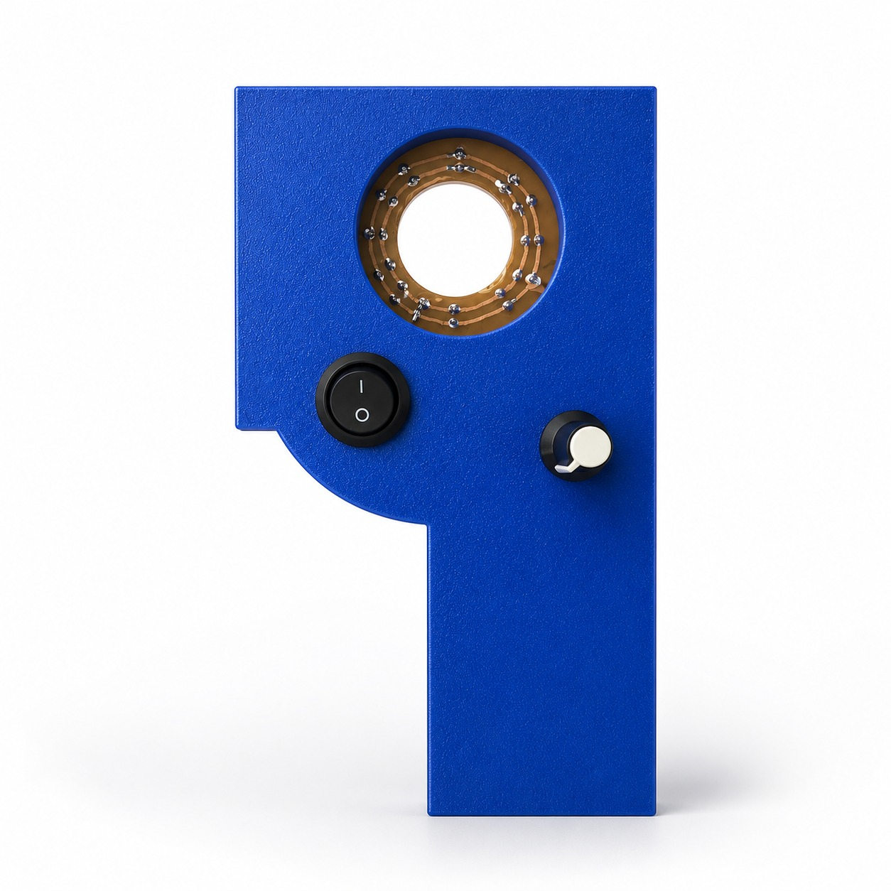
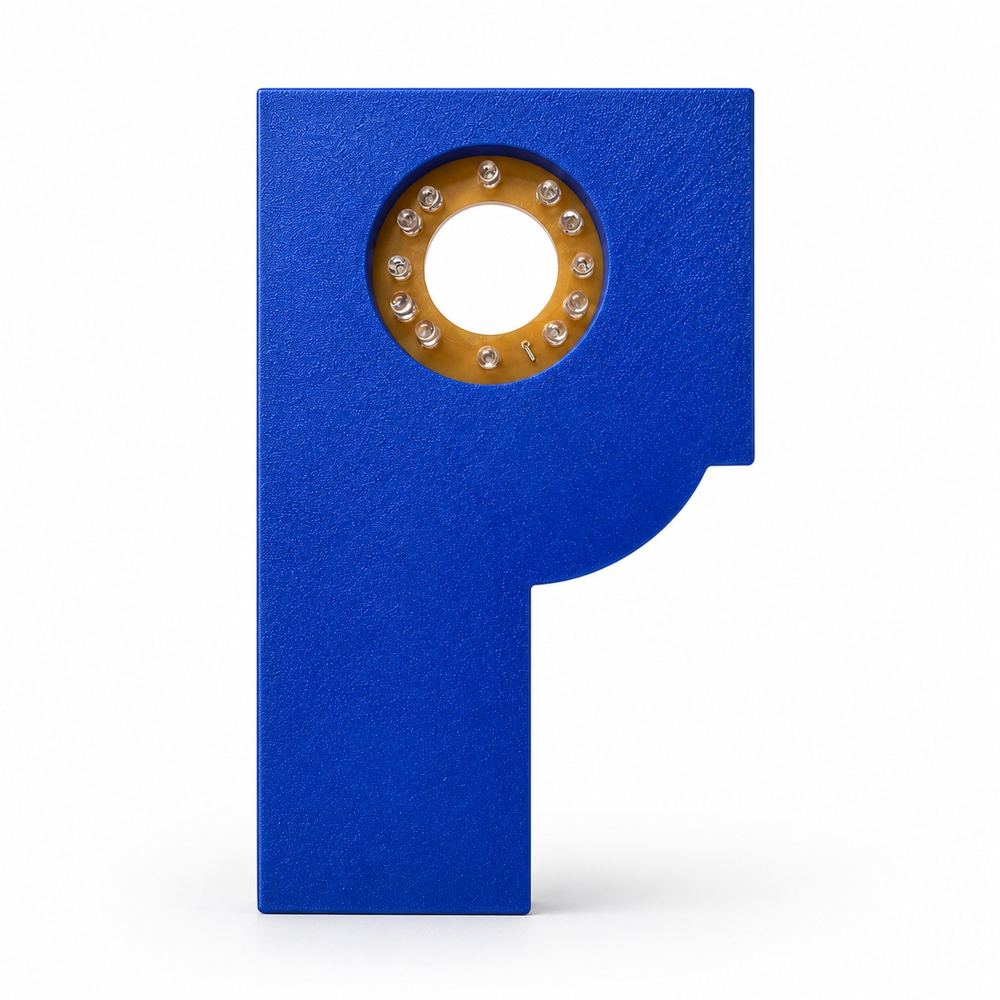
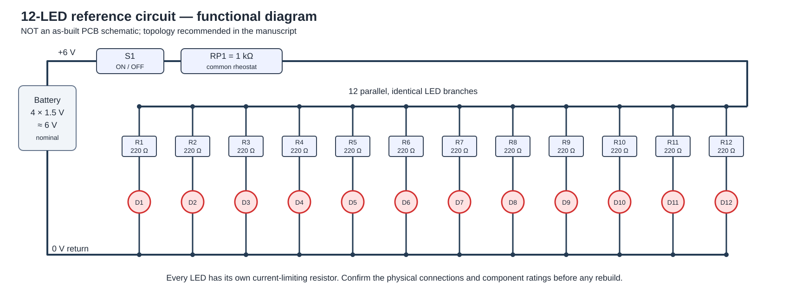
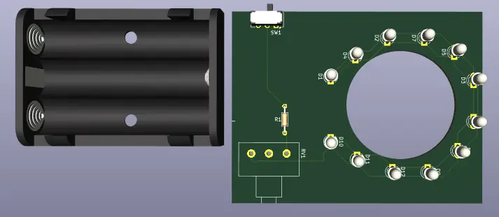
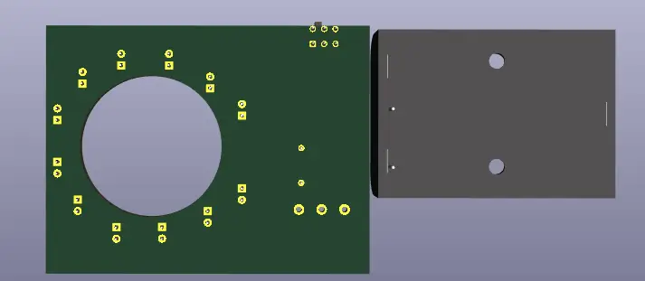
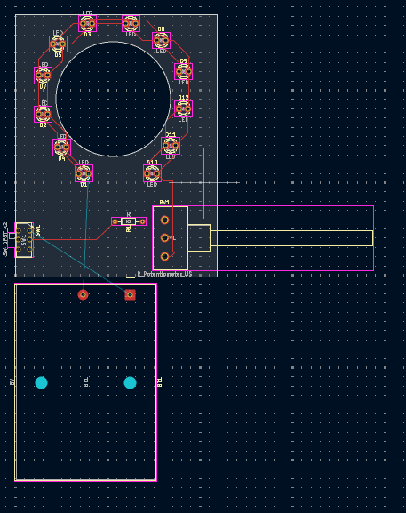
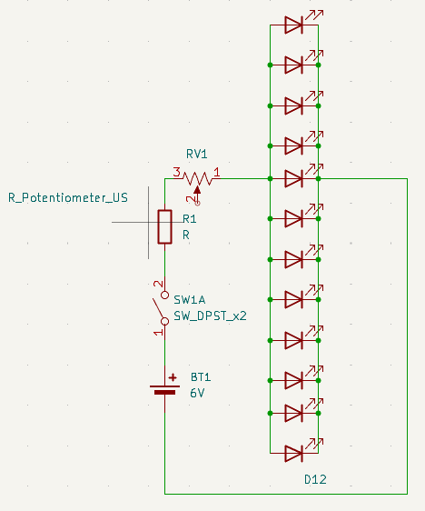
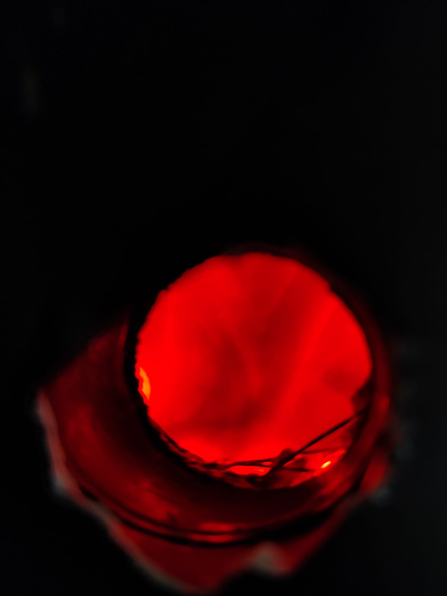
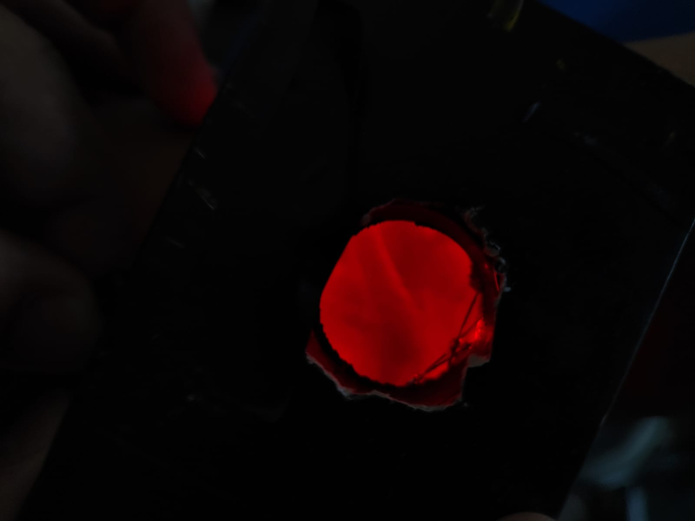

# Venoscópio portátil de baixo custo com LEDs vermelhos

**Protótipo acadêmico de Engenharia Biomédica para visualização qualitativa de veias superficiais por iluminação vermelha visível.**

> **Exclusivamente para ensino e pesquisa.** Não é um equipamento médico certificado e não deve ser usado para orientar punções venosas ou decisões clínicas. Os resultados ópticos numéricos são **estimativas teóricas**, e não medições experimentais.

[Artigo completo em PDF](article/venoscope-paper.pdf) · [English README](README.md) · [Pendências de reprodutibilidade](docs/reproducibility-checklist.md)

## Apresentação do projeto

O projeto estuda o contraste visual entre vasos superficiais e tecido adjacente com um conjunto de **12 LEDs vermelhos** distribuídos ao redor de uma abertura central. O dispositivo relatado no artigo possui carcaça modelada no Tinkercad e impressa em 3D, placa cobreada fabricada manualmente, quatro pilhas de 1,5 V em série, chave liga/desliga e potenciômetro de 1 kΩ para controle de brilho.

Diferentemente dos localizadores venosos no infravermelho próximo (NIR), **não há câmera NIR, processamento digital de imagens ou projeção de vasos**. A observação é direta e melhora com a redução da iluminação ambiente.

| Frente — Figura 1 do artigo | Face com LEDs — Figura 2 do artigo |
|:--:|:--:|
|  |  |

## Principais características técnicas

| Item | Especificação / situação |
|---|---|
| Emissão óptica | 12 LEDs vermelhos; ~630 nm **assumidos nos cálculos**, sem identificação do fabricante |
| Alimentação | Quatro pilhas de 1,5 V em série (6 V nominais) |
| Controle | Chave liga/desliga e potenciômetro de 1 kΩ, usado como reostato |
| Circuito de referência | 12 ramos em paralelo, cada um com 1 LED e 1 resistor de 220 Ω |
| Corrente teórica máxima nominal | 17,27 mA por LED; aproximadamente 207 mA no conjunto |
| Potência teórica por resistor | 65,6 mW; recomenda-se componente de ¼ W |
| Potenciômetro | Dissipação teórica máxima de aproximadamente 0,20 W; recomenda-se ≥0,5 W |
| Construção | Carcaça impressa em 3D e placa corroída com percloreto de ferro |
| Firmware | Inexistente; controle analógico manual |

**Atenção:** a associação de **220 Ω por LED é uma topologia recomendada no artigo**, não uma confirmação do circuito físico existente. O manuscrito pede expressamente a verificação das trilhas, componentes e correntes reais. **Os arquivos KiCad fornecidos posteriormente estão incluídos abaixo, mas ainda não foram conferidos com o protótipo físico.** O diagrama abaixo **não representa um esquemático conferido da placa montada**.



### Projetos editáveis no KiCad

- [Esquemático KiCad (`Venoscopio.kicad_sch`)](hardware/kicad/Venoscopio.kicad_sch)
- [Layout da PCB KiCad (`Venoscopio.kicad_pcb`)](hardware/kicad/Venoscopio.kicad_pcb)
- [Diferenças entre os arquivos KiCad e o artigo](docs/kicad-vs-paper.md)

**Atenção:** o esquemático fornecido apresenta **um resistor R1 para os 12 LEDs**, enquanto o artigo recomenda **um resistor individual de 220 Ω em cada ramo**. O layout utiliza footprint de **suporte para 3 pilhas AAA** e **LEDs de 3 mm**, diferentemente do cenário do artigo (quatro pilhas e LED típico de 5 mm assumido nos cálculos). Os valores de R1 e RV1 também não foram preenchidos nos campos dos componentes. Isso não comprova que o circuito físico possua a mesma configuração: é necessário conferir a montagem antes de afirmar a topologia real ou fabricar uma revisão.

### Imagens do projeto no KiCad

As quatro imagens a seguir são **capturas do projeto CAD enviado**, e não fotografias que comprovem a configuração elétrica da placa fabricada.

| Visualização 3D — face dos componentes/LEDs | Visualização 3D — face oposta |
|:--:|:--:|
|  |  |

| Layout da PCB | Esquemático elétrico |
|:--:|:--:|
|  |  |

**Situação da revisão:** as imagens não demonstram que todas as trilhas estejam roteadas, nem substituem verificações ERC/DRC. Antes de fabricar, é necessário conferir conexões, valores de componentes, suporte de pilhas e a correspondência entre o CAD e a montagem real. Consulte as [observações técnicas](docs/kicad-vs-paper.md).

### Acabamento da carcaça e máscara de proteção (proposta para a versão final)

Para a versão final, **recomenda-se a cor preta, preferencialmente com acabamento fosco**, com o objetivo de reduzir reflexos indesejados da iluminação vermelha nas superfícies próximas à área de observação e proporcionar um acabamento visual mais uniforme. Essa escolha ainda **não foi avaliada por meio de medições ópticas comparativas**.

Também se propõe a inclusão de uma **máscara mecânica opaca** posicionada **entre a superfície da carcaça e a PCB**. Essa peça deve **ocultar os pontos de soldagem e as conexões expostas dos LEDs**, mantendo livres as regiões emissoras dos componentes e a abertura central de observação. Sua geometria, fixação e folgas deverão ser definidas no projeto 3D para garantir isolamento elétrico e facilitar a montagem.

Neste contexto, o termo *máscara* designa uma **peça física de acabamento e proteção**, e **não a máscara de solda aplicada à PCB**. Tanto a cor preta quanto essa peça são **melhorias propostas para uma futura revisão**, não características já implementadas ou testadas no protótipo atual.

## Fundamentação e resultados

A partir de coeficientes ópticos obtidos na literatura, o artigo apresenta estimativas para um cenário ilustrativo de percurso equivalente de **1,5 mm na pele** e absorção adicional de **1,5 mm por sangue venoso**:

| Estimativa do modelo | Resultado |
|---|---:|
| Coeficiente de atenuação efetiva na pele | 0,671 mm⁻¹ |
| Intensidade difusa remanescente após a pele | **36,5% de I₀** |
| Intensidade prevista para percurso com segmento venoso | **8,3% de I₀** |
| Contraste idealizado | **77,3%** |

**O contraste de 77,3% é exclusivamente teórico**, e não corresponde à precisão de detecção, taxa de sucesso em punções ou contraste medido nas fotografias. O modelo simplifica espalhamento, geometria, pigmentação e trajetórias da luz.

### Fotografias da observação qualitativa

| Figura 4 do artigo | Figura 5 do artigo |
|:--:|:--:|
|  |  |

Em condições de iluminação ambiente reduzida, as fotografias mostram trajetos mais escuros **compatíveis com vasos superficiais**. Não houve avaliação clínica controlada, comparação quantitativa com equipamentos comerciais nem medição de profundidade ou sensibilidade.

## Organização do repositório

- [`article/`](article/): manuscrito original em PDF.
- [`assets/figures/`](assets/figures/): figuras extraídas do manuscrito.
- [`hardware/schematic/`](hardware/schematic/): diagrama **conceitual** derivado do artigo.
- [`hardware/kicad/`](hardware/kicad/): esquemático e PCB **editáveis**, mais quatro capturas de tela; revisão ainda não validada.
- [`hardware/pcb/`](hardware/pcb/): local para Gerbers verificados, fotos das faces e demais dados de fabricação, quando obtidos.
- [`hardware/enclosure/`](hardware/enclosure/): local para STL/STEP e projeto 3D original.
- [`analysis/`](analysis/): scripts que reproduzem os cálculos teóricos.
- [`docs/`](docs/): lista de componentes, verificações pendentes e protocolo futuro.
- [`tests/`](tests/): testes dos cálculos numéricos.

Para reproduzir os cálculos e o gráfico teórico de brilho:

```bash
python -m pip install -r requirements.txt
python analysis/reproduce_models.py --output-dir analysis/generated
python -m unittest discover -s tests -v
```

Esses scripts **não controlam o dispositivo** e não analisam imagens clínicas.

## O que falta para publicar um projeto totalmente reproduzível?

1. **Eletrônica real:** fotos da frente e verso da placa, identificação dos componentes, multímetro para continuidade, esquemático conferido e layout da PCB.
2. **Modelo 3D:** arquivos editáveis/STL, dimensões, detalhes da montagem e compartimento das pilhas, além do acabamento preto fosco e da máscara mecânica proposta para ocultar as soldas dos LEDs.
3. **Resultados medidos:** corrente e tensão por faixa de brilho, temperatura, autonomia e irradiância.
4. **Ensaios controlados:** ambiente e exposição fotográfica padronizados, medida objetiva de contraste e ensaios com fantoma óptico.
5. **Melhoria futura:** controle com MOSFET/PWM e investigação de comprimentos de onda alternativos, após revisar segurança óptica.

Confira [`docs/reproducibility-checklist.md`](docs/reproducibility-checklist.md) e [`docs/experimental-protocol.md`](docs/experimental-protocol.md). **Esses documentos descrevem propostas, e não estudos já executados.**

## Autores

- **Evellyn de Abreu** — [ORCID](https://orcid.org/0009-0009-8709-1542)
- **Lucas Silva Souza** — [ORCID](https://orcid.org/0009-0008-6328-7826)
- **Matheus Henrique Cruz** — [ORCID](https://orcid.org/0009-0001-3356-7199)

Faculdade de Engenharia Elétrica, Universidade Federal de Uberlândia (UFU), Brasil.

Antes de tornar o repositório público, alinhe as permissões de divulgação do artigo e das fotografias com os três autores. O repositório não afirma que o manuscrito tenha sido aceito por periódico ou que possua DOI. Consulte [`LICENSE-NOTICE.md`](LICENSE-NOTICE.md).
