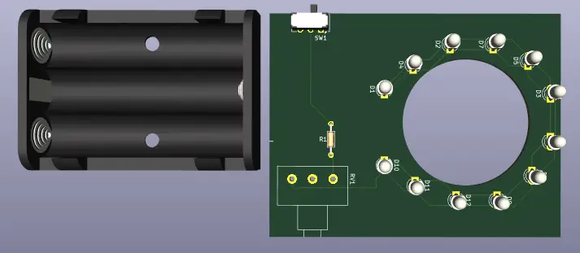
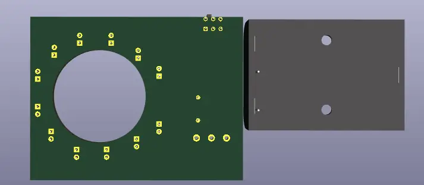
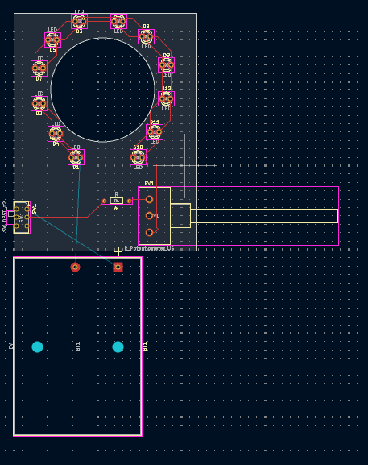
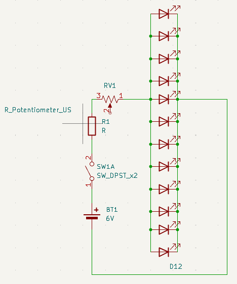

# KiCad source — supplied design (unverified)

These files were provided by a project contributor and copied here **without modifying their internal content**:

- `Venoscopio.kicad_sch` — editable KiCad 10 schematic;
- `Venoscopio.kicad_pcb` — editable KiCad 10 PCB layout.

Both filenames were normalized to ASCII for convenient GitHub paths. They must be kept together with the same basename. You can open them individually in KiCad; no `.kicad_pro` file was supplied.

**Status:** They document a supplied design revision, not necessarily the assembled board. The documents have not been validated with ERC, DRC, multimeter measurements, or a hardware inspection. Read [`../../docs/kicad-vs-paper.md`](../../docs/kicad-vs-paper.md) before using them to fabricate anything.

Do not mistake the SVG under `../schematic/` for an export of this KiCad schematic; that SVG represents the recommended article topology.

## Visual previews provided with these sources

| Component-side 3D render | Reverse-side 3D render |
|:--:|:--:|
|  |  |

| PCB layout screenshot | Schematic screenshot |
|:--:|:--:|
|  |  |

These are screenshots of the **supplied CAD design**, not photographs or verified electrical/manufacturing outputs. The PCB editor screenshot may show incomplete routing; no ERC/DRC verification is claimed.
